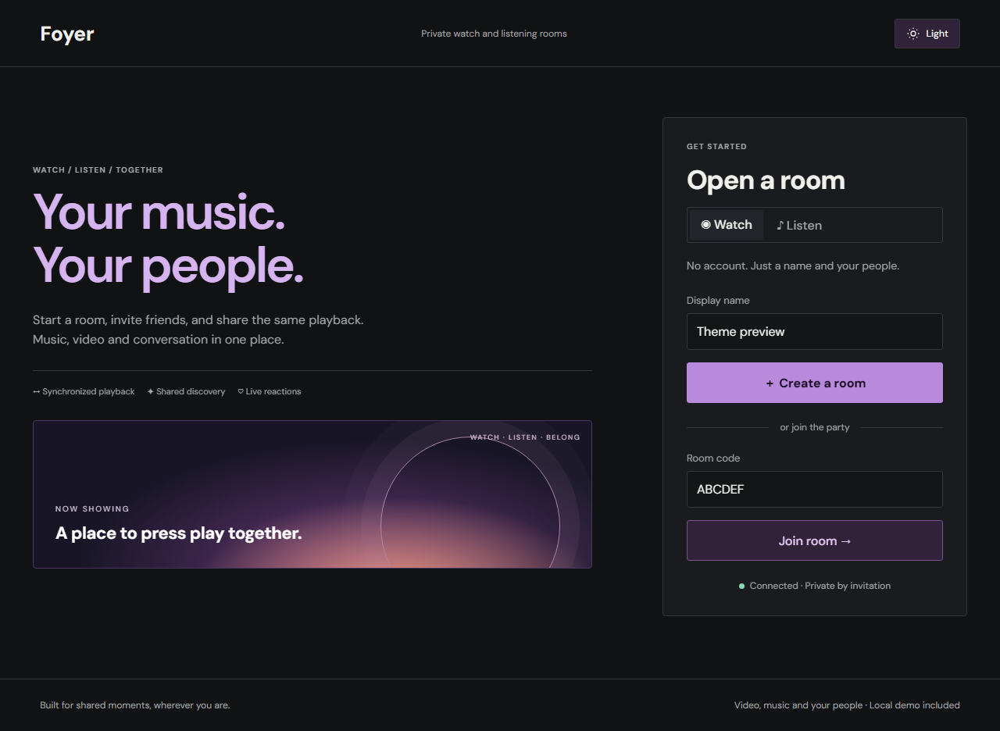

# Foyer

**Watch. Listen. Belong.**

Real-time watch and listening rooms with synchronized playback, music discovery, and shared conversations. Invite friends with a room code or link; no Foyer account is required.

[](https://github.com/krishnaagarwal2025-a11y/Foyer/actions/workflows/ci.yml)


[**Live demo**](https://foyer-cyan.vercel.app) · [Walkthrough](docs/demo.md) · [Architecture](docs/architecture.md) · [Deployment](docs/deployment.md)



## Features

- Host-controlled play, pause, seek, device handshakes, and automatic drift correction.
- Watch and Listen modes with in-app music search, shared queues, and group recommendations.
- Live chat, spoiler controls, reactions, polls, queue votes, and timestamp bookmarks.
- Stable reconnect identities, host transfer, and server-side permission checks.
- Responsive layouts, saved themes, vinyl artwork, cinema mode, and reduced-motion support.
- Bundled playable video and original audio; no API key needed for the core local demo.

## Quick start

Requires **Node.js 24** and npm.

```sh
git clone https://github.com/krishnaagarwal2025-a11y/Foyer.git
cd Foyer
npm ci
npm run dev
```

Open **http://localhost:5173**. The frontend and backend start together. Create a room, then open its invitation in another browser profile or device. Discover opens first; Watch starts empty until a video is selected.

For a single-origin production-style local demo:

```sh
npm run build
npm start
```

Open **http://localhost:3001**. Other devices on the same network can use `http://YOUR_LAN_IP:3001` if the firewall permits it.

Default local setup needs no environment configuration. Optional server settings are in [config/.env.example](config/.env.example); environment files are not automatically loaded. Keep credentials server-side.

## Media support

| Source                                   | Integration                                                                 |
| ---------------------------------------- | --------------------------------------------------------------------------- |
| Bundled samples, direct audio/video      | Native HTML5 playback                                                       |
| On-demand HLS                            | Native support or HLS.js; live HLS is not synchronized                      |
| YouTube, Vimeo, SoundCloud               | Official embeds; provider restrictions and autoplay rules apply             |
| Audius                                   | Artist-published music discovery and streaming                              |
| Navidrome                                | Optional connection to your own music library                               |
| Netflix, Prime Video, Hotstar/JioHotstar | Experimental companion extension; each viewer needs personal service access |

Foyer does not supply commercial movie streams, extract YouTube audio, or bypass DRM. YouTube players remain visible. The companion is a developer-install extension, not a browser-store release. See the [media and extension guide](docs/usage.md).

## Development

```sh
npm test                         # Unit and integration tests
npm run build                    # Type check, frontend, extension package
npx playwright install chromium # One-time browser installation
npm run test:browser              # Browser workflows
npm run test:extension            # Extension packaging and permissions
```

Browser tests start the development server automatically. Set `DEMO_URL` to test an existing server; `LOW_MEMORY=1` reduces Chromium allocations.

With the local server running, use `npm run benchmark`, `npm run benchmark:browser`, or `npm run benchmark:sync`. Generated reports stay in ignored `evidence/`. Historical results and limitations are in [Performance](docs/performance.md); socket timing is not proof of browser video synchronization.

## Architecture

React, TypeScript, and Vite power the interface. Express and Socket.IO own versioned room state and server-time playback anchors. SQLite persists local rooms; shared Redis coordination is optional for the Vercel deployment. Full snapshots restore late joins and reconnects; operation IDs deduplicate commands.

| Directory            | Purpose                                             |
| -------------------- | --------------------------------------------------- |
| `src/`               | Interface and media adapters                        |
| `client/`, `config/` | HTML entry point and tool configuration             |
| `server/`, `shared/` | Room engine, persistence, protocol, synchronization |
| `extension/`, `api/` | Companion and Vercel entry point                    |
| `public/`            | Demo media, help pages, bundled font                |
| `scripts/`, `tests/` | Tooling, benchmarks, automated checks               |
| `docs/`              | Guides, selected measurements, preview assets       |

## Documentation

[Demo](docs/demo.md) · [Usage and troubleshooting](docs/usage.md) · [Synchronization](docs/architecture.md) · [Performance](docs/performance.md) · [Deployment](docs/deployment.md) · [Requirements](docs/requirements.md) · [Presentation notes](docs/presentation.md)

See [Contributing](.github/CONTRIBUTING.md) and [Security](.github/SECURITY.md). The bundled font retains its [SIL Open Font License](public/fonts/JetBrainsMono-OFL.txt).

Tool configuration lives in `config/`; use the npm commands above so the correct paths are selected. The root `tsconfig.json` is a minimal discovery entry for editors and deployment tools, and `vercel.json` remains at the root for Vercel.
