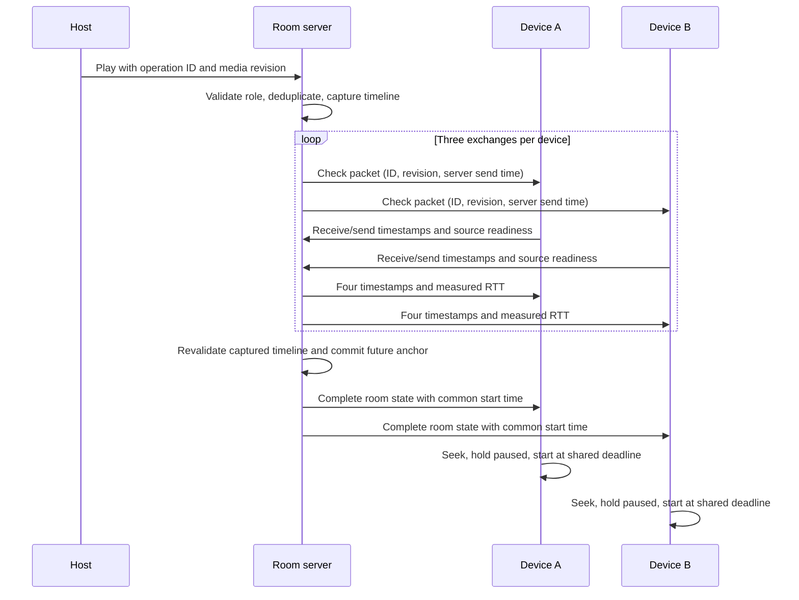

# Foyer device-check synchronization protocol

Foyer measures both devices through the server. Three check exchanges run concurrently for each currently connected participant before a Play request, a queued winner, automatic advancement, and manual sync. This works for direct audio/video and supported provider players. The companion bridges the same packets to its service tab.

For each exchange, `s0` is server send, `c1` client receive, `c2` client send and `s3` server receive. The server measures elapsed RTT with a monotonic clock and subtracts the client's processing interval `c2 - c1`. The client estimates server-minus-client offset as `((s0 - c1) + (s3 - c2)) / 2`. The lowest-RTT sample limits jitter. Offset and one-way delay remain estimates: asymmetric routes cannot be recovered exactly from round trips. No raw unsynchronized wall-clock difference is treated as latency.

The common-start lead is `clamp(1.5 × maximum measured RTT + 80 ms, 120 ms, 1500 ms)`. After checking, the server commits `anchor = serverNow + lead`. The position stays fixed before that anchor. Clients hold playback and use an aligned timer to start; normal drift correction continues afterwards. A pause cancels the pending start. A seek or duration confirmation during countdown preserves its deadline. Media changes invalidate the old check. Concurrent timeline changes during preparation are rejected; successful operation IDs are deduplicated before a repeat probe.

Each packet has a 300-ms acknowledgement timeout; the collector waits up to one second for reports. Missing responses and sources still loading are reported honestly. Ready devices receive a scheduled start and waiting devices catch up when loaded; one missing or buffering device does not hold everyone indefinitely. Autoplay permission is still enforced by each browser. A known restriction is reported and the user can click to sync and play. Source readiness does not promise that browser autoplay will be allowed.

Manual sync performs the room-wide delay check, fetches the latest authenticated snapshot afterwards, and force-corrects only the requesting player. It resets playback rate, retries playback within the initial user gesture and confirms success only after a server response and a matching player state/timeline. It does not reschedule the room or grant guest control.

In cloud mode, Redis Pub/Sub carries check requests and server-generated reports to all function instances. Each worker probes only its locally connected, current lease-owned members. The final playback mutation still uses the existing fenced room transaction. A single latest check is retained in the public room snapshot; pending checks and seen IDs are bounded. The People view displays measured RTT and source readiness; diagnostics show the estimated clock offset and drift.

Evidence: `tests/sync-protocol.test.ts`, `tests/browser/protocol.spec.ts`, `tests/browser/sync.spec.ts`, `tests/browser/youtube.spec.ts`, `evidence/protocol-cross-instance.json`, and the `protocol-*-benchmark` / `protocol-*-browser` reports. Socket-only tests use synthetic readiness and do not establish media playback. Localhost performance is separate from public Internet performance, and the deliberate common-start lead is included in player-application timing.
