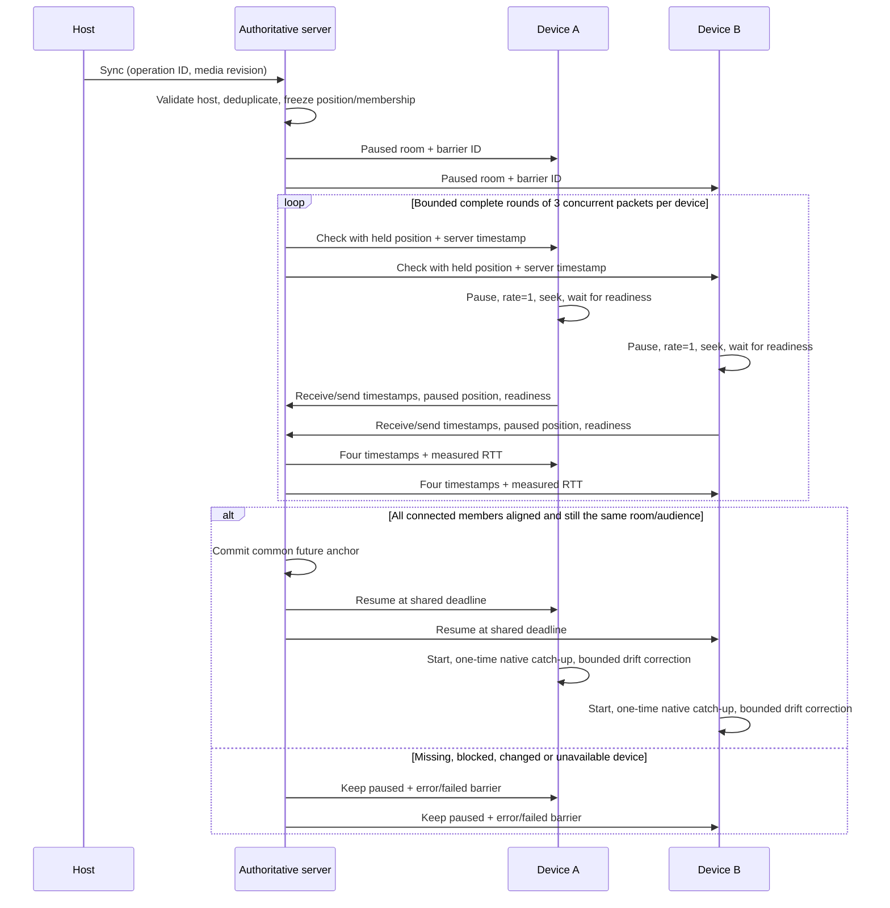

# Foyer synchronization protocol

The server owns media revision, play/pause state, position at a server-time anchor and increasing state version. While playing, expected position is `position + max(0, estimatedServerNow - anchor) / 1000`, clamped to duration. Clients ignore stale versions and apply only the loaded, seekable source.

## Host room synchronization

**Sync room** / **S** is always host-only. It pauses a playing room and starts a paused room only after the complete handshake. Guests retain automatic catch-up and a separate local autoplay permission action; they cannot invoke room sync through the UI, a raw socket request or collaborative control.

Each connected member must report three valid samples, the correct source revision, paused state, source readiness, no known autoplay block, and an absolute paused position difference of at most **80ms**. Clients seek differences above 10ms during the packet handler and wait for buffering/seeking before acknowledging. The server checks membership and host again before finishing; new joins/disconnections require a retry rather than silently dropping a device. Chat, votes and presence can change state versions without changing the held timeline. Controls that would move the timeline are rejected while waiting; explicit Pause cancels the barrier.

Readiness waits default to 10s (`ROOM_SYNC_TIMEOUT_MS`, bounded to 0.2–12s). A barrier packet can wait 1.5s for its acknowledgement and its collector waits up to 2s; retries consist of complete three-packet rounds. Abandoned barriers expire paused after 15s. Long waits run outside the socket command queue so cancellation and disconnect remain responsive. Source changes, cancelled IDs, changed hosts/audiences and stale reports cannot commit an obsolete resume. Successful operation IDs are deduplicated. SQLite restart restoration discards active barriers and restores paused playback.

## Clock estimation and scheduled start

For server send `s0`, client receive `c1`, client send `c2` and server receive `s3`, offset (server minus client) is `((s0 - c1) + (s3 - c2)) / 2`. RTT uses a server monotonic elapsed clock, subtracting client processing `c2 - c1`; seeking time is not mistaken for network delay. Lowest-RTT samples reduce jitter. The shared lead is `clamp(1.5 × max RTT + 80ms, 120ms, 1500ms)`. The server commits `anchor = serverNow + lead`; clients hold position and schedule starts against their estimated server clocks.

Normal Play, queued winners, automatic advancement and selected music-search results also use the three-packet clock check and future anchor. These starts allow a loading device to catch up; the host Sync action is the strict all-device pause barrier.

Cloud mutations reload shared Redis state under a fenced per-room lock and commit before publishing. Pub/Sub distributes checks and reports across workers; only current lease-owned sockets are probed. Tokens never appear in public snapshots. Workers are assumed to have closely aligned system epochs; client estimates and provider time values are not independently trusted frame/speaker measurements.

## Correction and limitations

Native playback receives one force correction after a successful manual-barrier restart to compensate decode/start delay. Ordinary 100ms checks seek large (>500ms) errors, apply bounded ±5% rates for modest error, and reset rates near stability. Provider SDKs without reliable continuous rates use bounded seeks and wait for their asynchronous transitions. Corrections do not emit room commands. Fatal source errors stay latched until retry/source replacement, even if a paused SDK emits another ready event.

Browser autoplay still needs local permission. **Enable playback on this device** primes playback muted within a user gesture, then follows the authoritative pause/start state; it does not grant guest room control. Buffering, hidden-tab throttling, network asymmetry, timer jitter, variable frame rate and hardware output delay can prevent exact synchronization. A reported 0ms paused API-position difference does **not** prove zero clock offset, zero physical playback error or simultaneous presented frames/audio. No implementation can guarantee literal 0ms across arbitrary browsers and networks.

`npm run benchmark:sync` measures ten isolated browser contexts with actual local video/audio, reports pause/check/commit duration separately from resumed drift, and saves every trial. `npm run benchmark` measures transport-only delivery; `npm run benchmark:browser` separates normal event delivery, player-state application and drift. See PERFORMANCE.md for observed numbers and repeat conditions. Public Internet and localhost results are not labeled as physical-LAN or physical-phone verification.
